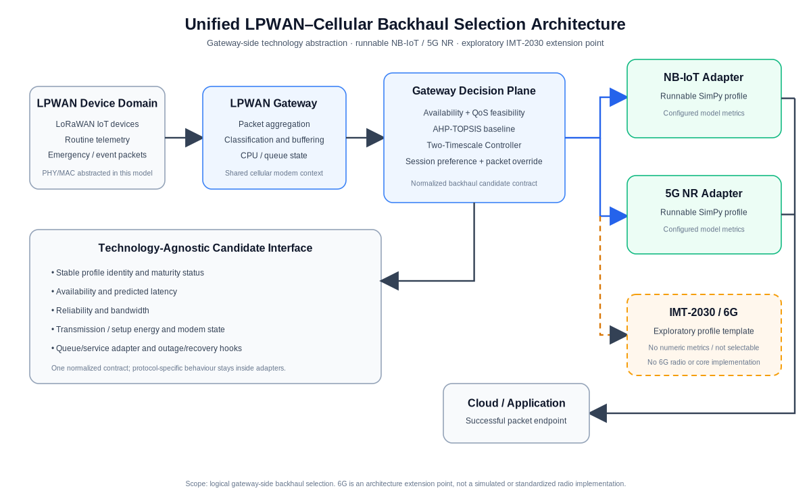
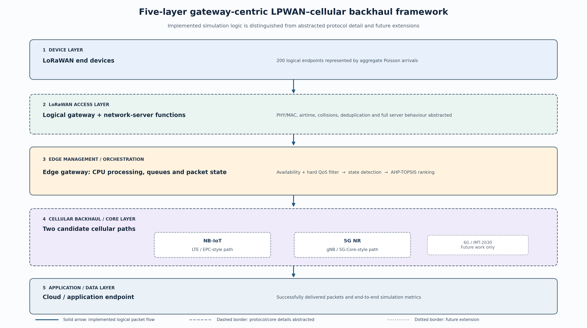
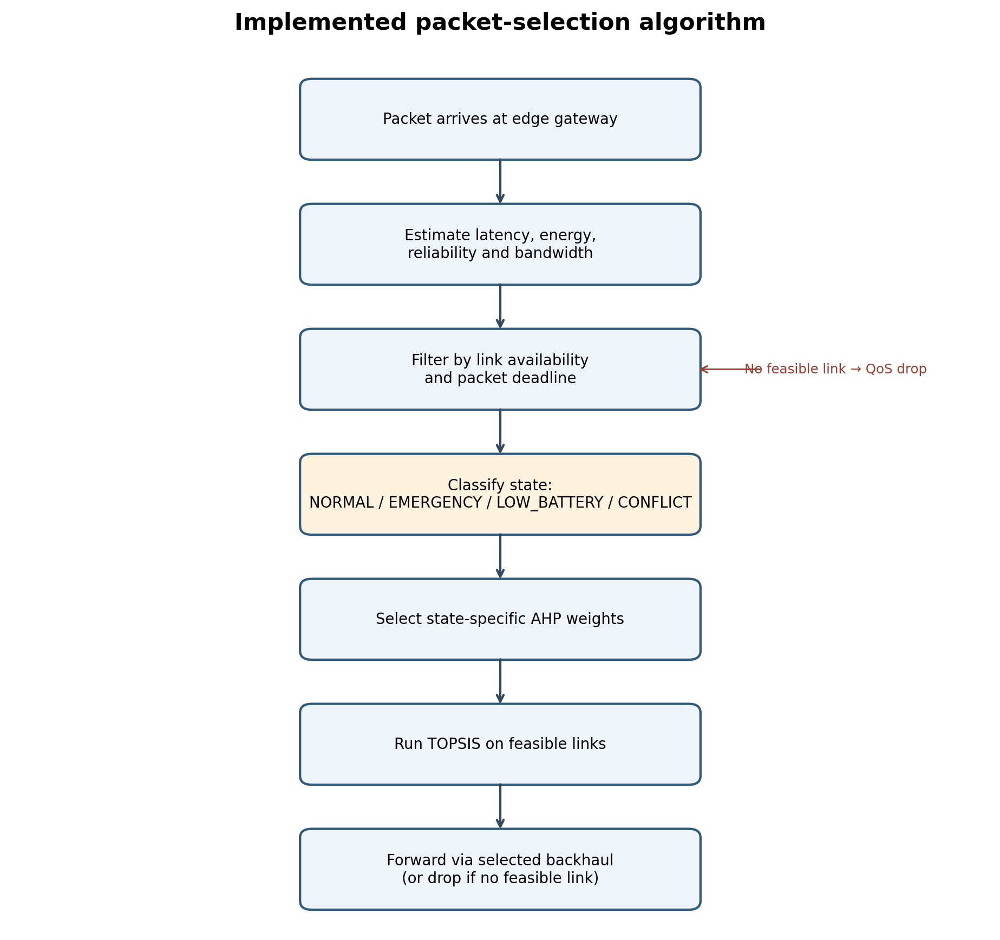
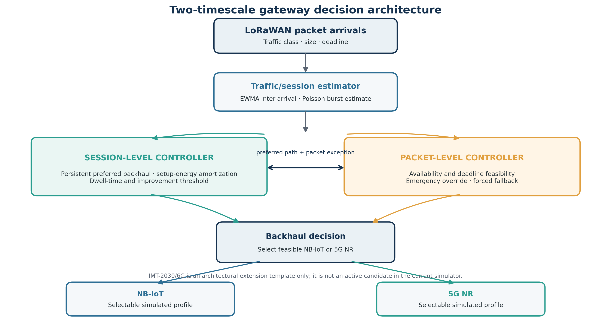
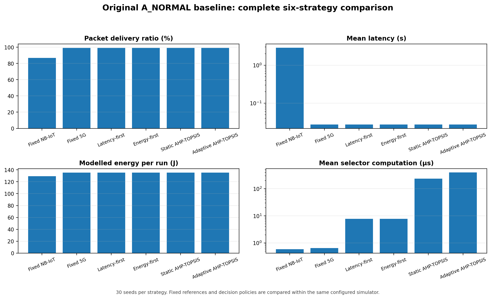
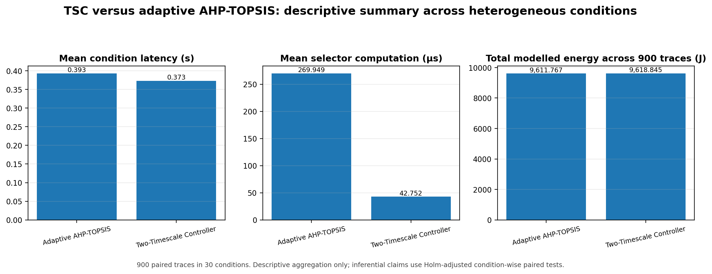
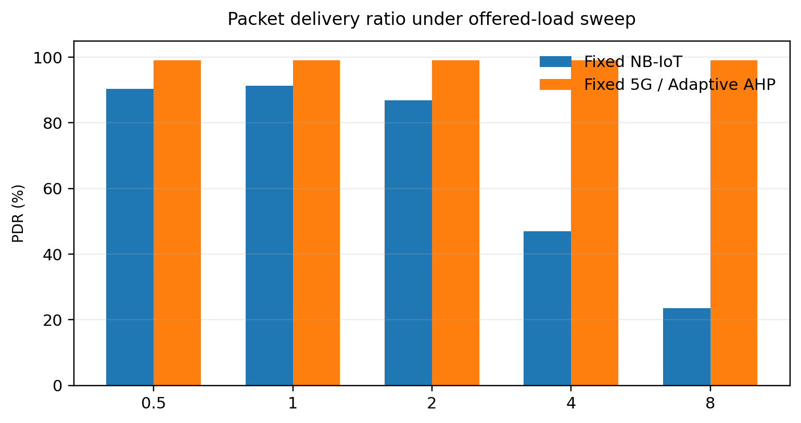
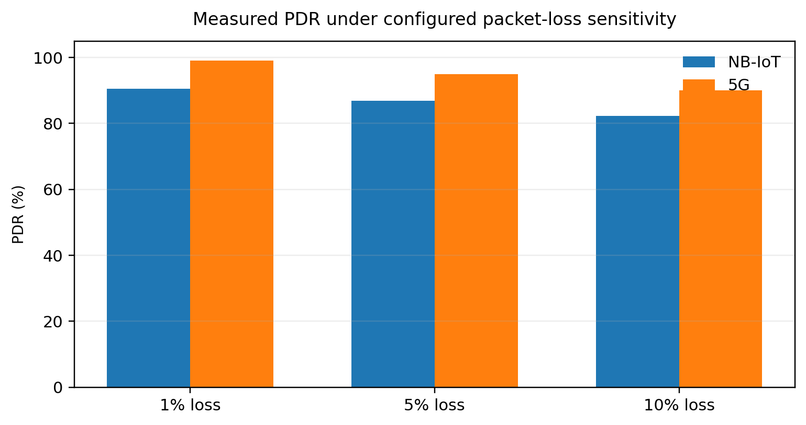
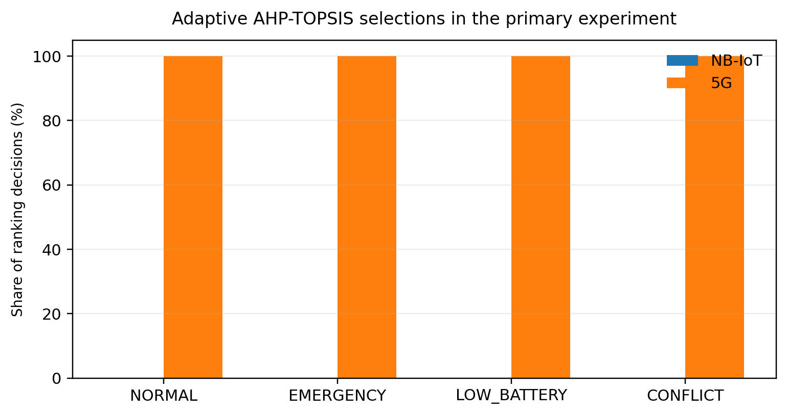
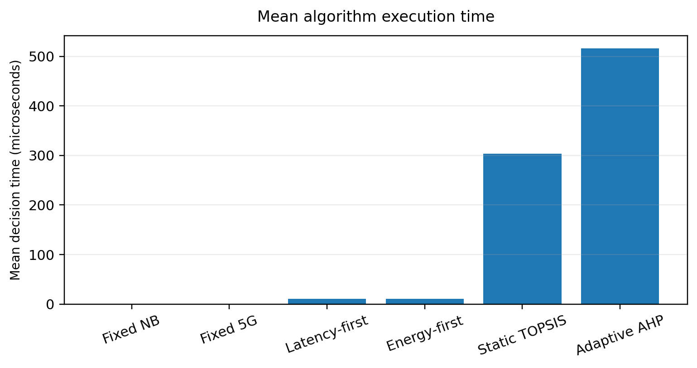

<div align="center">

  

  # Unifying 5G/6G with LPWAN

  ### Adaptive Edge-Gateway Backhaul-Selection Framework

  **Computer Networks Semester Project · Indian Institute of Information Technology Raichur**

  [](#-getting-started)
  [](#-simulation-and-methodology)
  [](#-gateway-decision-framework)
  [](#-two--timescale-controller)
  [](#-experimental-results)
  [](#-two--timescale-controller)
  [](#-algorithms-compared)
  [](#-scope-and-limitations)

  <br>

  **[Project Presentation](https://canva.link/e4gap65dmg8kar4)** ·
  **[IIIT Raichur](https://iiitr.ac.in/)** ·
  **[GitHub Repository](https://github.com/SamarthLambture/5G6G-LPWAN-Adaptive-Backhaul)**

</div>

<p align="center">
  
</p>

<p align="center">
  <em>Keep LoRaWAN as the IoT access technology. Make the onward cellular-backhaul decision at the edge gateway using packet feasibility, traffic context and a common technology-adapter interface.</em>
</p>

---

## Contents

- [Project overview](#-project-overview)
- [The problem](#-the-problem)
- [Project contributions](#-project-contributions)
- [Framework architecture](#-framework-architecture)
- [Gateway decision framework](#-gateway-decision-framework)
- [Two-Timescale Controller](#-two-timescale-controller)
- [Simulation and methodology](#-simulation-and-methodology)
- [Algorithms compared](#-algorithms-compared)
- [Experimental results](#-experimental-results)
- [Supplementary outage/recovery pilot](#-supplementary-outagerecovery-pilot)
- [Interactive application](#-interactive-application)
- [Repository structure](#-repository-structure)
- [Getting started](#-getting-started)
- [Validation and reproducibility](#-validation-and-reproducibility)
- [Academic deliverables](#-academic-deliverables)
- [Documentation](#-documentation)
- [Project team](#-project-team)
- [Scope and limitations](#-scope-and-limitations)
- [License](#license)

---

## 🔎 Project overview

Internet of Things (IoT) deployments generate traffic with different service requirements. Periodic telemetry can often tolerate a longer delivery time, while alarms and emergency messages may have strict packet deadlines. A gateway that always uses one fixed cellular backhaul may not handle every traffic condition or network-availability event equally well.

This project develops and evaluates a **gateway-centric framework for selecting a cellular backhaul for LoRaWAN-originated IoT traffic**. Low-power devices use LoRaWAN for access. A logical edge gateway receives and processes their packets, checks which cellular backhaul candidates are available and capable of meeting each packet's deadline, and selects an onward path from two implemented simulation candidates:

- **NB-IoT / LTE-style cellular backhaul**
- **5G NR / 5G-Core-style cellular backhaul**

The reference decision pipeline applies a hard availability and quality-of-service (QoS) feasibility filter, classifies the gateway operating state, and ranks the feasible candidates using state-dependent Analytic Hierarchy Process (AHP) weights and Technique for Order Preference by Similarity to Ideal Solution (TOPSIS).

The research upgrade introduces a **Two-Timescale Controller (TSC)**. It maintains a slower session/burst-level backhaul preference while preserving faster packet-level handling for emergency traffic and forced fallback when a preferred path is unavailable or infeasible. The project also defines a normalized backhaul profile/adapter contract and records an exploratory IMT-2030/6G profile as a future extension point.

> **Project scope:** this is a Python/SimPy discrete-event simulation with an interactive browser application. It is not a physical radio deployment, a standards-complete LoRaWAN/3GPP interworking system, or an implementation of a 6G radio or core network.

## 🎯 The problem

The central design question is:

> **How can an edge gateway select an available cellular backhaul for LoRaWAN-originated traffic while respecting individual packet deadlines and considering latency, energy, reliability and bandwidth?**

The project separates the IoT access technology from the cellular backhaul. LoRaWAN devices do not directly select or operate NB-IoT/5G radios. The gateway is the decision and coordination point between the LPWAN-side traffic and the onward cellular path.

The work investigates two related decision problems:

1. **Packet-level feasibility and selection:** reject unavailable or deadline-infeasible candidates before applying a multi-criteria ranking method.
2. **Session/burst-level preference:** avoid treating every routine packet as an unrelated modem-selection event, while retaining packet-level emergency overrides and availability fallback.

## ✨ Project contributions

The project does not claim to invent LoRaWAN, NB-IoT, 5G NR, AHP or TOPSIS. Its contribution is the integration and evaluation of a gateway-side decision framework and its two-timescale policy extension.

| Existing technology or method | Project implementation | Evidence boundary |
|---|---|---|
| LoRaWAN | Represents LoRaWAN-originated IoT telemetry and event traffic entering a logical gateway | Detailed LoRaWAN PHY/MAC, airtime and collision behaviour are abstracted. |
| NB-IoT and 5G NR | Models two distinct cellular backhaul candidates using configured service, availability and energy parameters | These are simplified simulation profiles, not physical modem or operator-network measurements. |
| AHP and TOPSIS | Filters infeasible candidates, determines one of four gateway states, applies state-dependent design weights and ranks feasible candidates | Weight vectors are specified by design. Pairwise matrices are generated from weight ratios and are consistent by construction, not independently elicited from experts. |
| Six-strategy evaluation | Compares fixed NB-IoT, fixed 5G, latency-first, energy-first, static AHP-TOPSIS and adaptive AHP-TOPSIS | The primary baseline shows that all five strategies that select 5G have identical packet metrics at the reported operating point. |
| Two-Timescale Controller | Adds EWMA arrival-rate estimation, a Poisson expected-burst approximation, amortized setup-energy preference, packet-level emergency override, dwell/improvement guard and forced fallback | Benefits are condition-dependent. No statistically significant PDR/emergency-PDR gain, switching reduction or overall energy saving was established. |
| Technology abstraction | Adds a normalized backhaul profile/adapter contract and an exploratory IMT-2030/6G profile entry | NB-IoT and 5G NR are selectable simulation profiles. The IMT-2030 entry is non-selectable and has no numeric performance model. |
| Browser application | Provides recorded research-result views and a simplified interactive browser-side demonstration, with an optional Python/SimPy API bridge | Browser-demo outputs are illustrative and are not new canonical SimPy experiment results. |

For the full implementation traceability and related-work comparison, see [Contribution and Performance Impact](docs/research/CONTRIBUTION_AND_PERFORMANCE_IMPACT.md), [Research Contribution](docs/research/RESEARCH_CONTRIBUTION.md) and [References and Related Work](docs/research/REFERENCES_AND_RELATED_WORK.md).

## 🏗 Framework architecture

The logical framework is organized into five layers:

1. **IoT device layer** — telemetry and event-generating endpoints.
2. **LPWAN access layer** — logical LoRaWAN-originated packet traffic; detailed radio access behaviour is abstracted.
3. **Gateway and edge-management layer** — packet reception, metadata, gateway state, CPU processing and queues.
4. **Backhaul decision and adapter layer** — availability/deadline filtering, AHP-TOPSIS or TSC selection, normalized candidate metrics and decision logging.
5. **Cellular backhaul and application layer** — the selected NB-IoT-style or 5G-NR-style path delivers packets to a logical application endpoint.

<p align="center">
  
</p>

The gateway is the point of coordination. The project does not convert LoRaWAN frames into native 5G waveforms, implement a converged EPC/5GC, or claim standards-level interworking.

### Packet-level decision flow

<p align="center">
  
</p>

The gateway first forms a feasible candidate set for packet \(p\):

\[
\mathcal{F}(p)=\{n\in\{\mathrm{NB},\mathrm{5G}\}: A_n=1\ \land\ \widehat{D}_{p,n}\leq d_p\}
\]

where \(A_n\) denotes candidate availability, \(\widehat{D}_{p,n}\) is the model-predicted packet delay and \(d_p\) is the packet deadline. Candidates that fail this filter are not passed into the TOPSIS ranking stage. If no candidate is feasible, the packet is recorded as a QoS drop.

## 🧠 Gateway decision framework

### Gateway operating states

The AHP state is determined by packet urgency and the gateway battery percentage. The low-battery threshold is **20%**.

| State | Condition | Latency | Energy | Reliability | Bandwidth |
|---|---|---:|---:|---:|---:|
| `NORMAL` | Non-emergency packet; battery ≥ 20% | 2/13 | 6/13 | 2/13 | 3/13 |
| `EMERGENCY` | Emergency packet; battery ≥ 20% | 4/8 | 1/8 | 2/8 | 1/8 |
| `LOW_BATTERY` | Non-emergency packet; battery < 20% | 1/8 | 5/8 | 1/8 | 1/8 |
| `CONFLICT` | Emergency packet; battery < 20% | 4/11 | 4/11 | 2/11 | 1/11 |

The criteria directions are:

- **Latency:** minimize.
- **Estimated energy:** minimize.
- **Configured reliability:** maximize.
- **Nominal bandwidth:** maximize.

The pairwise comparison matrix is generated as \(a_{ij}=w_i/w_j\) from each state weight vector. Its consistency follows mathematically from its construction; it should not be described as the result of an independent expert survey.

### Packet classes and deadlines

| Packet class | Payload used in the model | Deadline |
|---|---:|---:|
| Telemetry | 50 bytes | 10 seconds |
| Emergency / alarm | 200 bytes | 1 second |

### Configured backhaul candidates

The candidate parameters below are simulator settings. They are not universal technology specifications or measured commercial modem profiles.

| Parameter | NB-IoT / LTE-style | 5G NR / 5GC-style |
|---|---:|---:|
| Nominal bandwidth | 66 kbps | 100 Mbps |
| Base latency | 0.50 s | 0.02 s |
| Wake/setup delay | 1.50 s | 0.10 s |
| Setup energy | 1.50 J | 0.50 J |
| Transmit power | 1.0 W | 3.0 W |
| Configured reliability | 95% | 99% |
| Modem idle-tail timer | 2 s | 2 s |

These configured candidate inputs strongly favour 5G in much of the baseline parameterization. The observed strategy-selection results and this dominance effect are reported explicitly rather than attributed to an unverified adaptive advantage.

## ⏱ Two-Timescale Controller

The TSC is the principal research upgrade. It adds a slower gateway-level session/burst preference and retains a faster packet-level QoS decision.

### Timescale 1 — session/burst preference

- Updates an inter-arrival estimate using an **exponentially weighted moving average (EWMA)**.
- Uses a Poisson expected-burst approximation based on the estimated arrival rate and the modem idle-tail interval.
- Estimates setup-energy cost per expected packet to compare feasible candidates for a routine traffic burst.
- Uses a configurable minimum dwell time and relative-improvement threshold before replacing a still-feasible session preference.

### Timescale 2 — packet-level handling

- Applies the hard availability and packet-deadline feasibility filter for each packet.
- Allows emergency traffic to use the lowest-latency feasible candidate as a temporary packet-level override.
- Forces fallback if the stored session preference is no longer available or no longer meets the packet deadline.
- Records the decision reason and distinguishes temporary overrides from persistent preference changes.

The archived configuration uses an EWMA coefficient of 0.2, a 2-second minimum dwell time and a 10% relative-improvement threshold. These are configurable design parameters, not values established through an optimization or modem calibration study.

The expected-burst estimate is an analytical approximation for Poisson arrivals. It is not a learned traffic predictor, Markov-modulated Poisson process (MMPP) model or predictive queue-risk estimator.

<p align="center">
  
</p>

For the exact decision procedure and equations, see [Two-Timescale Method and Formulation](docs/research/TWO_TIMESCALE_METHOD_AND_FORMULATION.md).

## 🧪 Simulation and methodology

The canonical research framework is implemented in **Python using SimPy discrete-event simulation**. The primary baseline matrix and the supplementary TSC matrix are separate experiment families and must not be merged when reporting results.

### Primary six-strategy experiment

| Parameter | Configuration |
|---|---:|
| Primary operating configurations | 24 |
| Paired random seeds | 30 (`1000`–`1029`) |
| Strategies per configuration | 6 |
| Raw metric records | **4,320** |
| Simulation duration per run | 3,600 seconds |
| Arrival process | Aggregate Poisson process |
| Baseline offered load | 2 packets/second in the main operating point |
| Other offered loads | 0.5, 1, 2, 4 and 8 packets/second in load-sweep configurations |
| Packet payload/deadline | 50 B / 10 s telemetry; 200 B / 1 s emergency |
| Gateway low-battery threshold | 20% |
| Primary seed range | 1000–1029 |

The 24 configurations cover normal, emergency-heavy, low-battery, conflict, outage/latency-degradation, offered-load, energy-sensitivity, reliability-sensitivity and algorithm-overhead conditions. The primary 4,320-row dataset is an archived historical baseline that was audited and retained; it was not rerun for the TSC extension.

### TSC paired multi-operating-point experiment

| Dimension | Values |
|---|---|
| Offered load | 0.5, 1, 2, 4 and 8 packets/second |
| Emergency share | 10% and 25% |
| 5G availability pattern | No outage, single outage, repeated outages |
| Paired seeds per condition | 30 (`1000`–`1029`) |
| Duration per trace | 120 seconds |
| Total operating conditions | 30 |
| Paired input traces | **900** |
| Algorithm-run metric records | **1,800** |
| TSC decision records | **314,332** |

Within each condition and seed, AHP-TOPSIS and TSC use the same generated input trace. The paired analysis applies two-sided Wilcoxon signed-rank tests with Holm correction across 180 condition/metric comparisons. See [Experiments and Reproducibility](docs/reproducibility/EXPERIMENTS_AND_REPRODUCIBILITY.md) for experiment provenance and the complete command inventory.

## ⚖️ Algorithms compared

The original baseline experiment compares six strategies:

1. **Fixed NB-IoT** — always selects NB-IoT when it is feasible.
2. **Fixed 5G** — always selects 5G when it is feasible.
3. **Latency-first** — selects the feasible candidate with the lowest predicted latency.
4. **Energy-first** — selects the feasible candidate with the lowest estimated energy.
5. **Static AHP-TOPSIS** — ranks feasible candidates using equal criterion weights.
6. **Adaptive AHP-TOPSIS** — uses the gateway-state-specific AHP weights before TOPSIS ranking.

The TSC is evaluated separately against the adaptive AHP-TOPSIS baseline. It is not one of the six original primary strategies and its 900-trace matrix is not part of the 4,320-row primary experiment.

## 📊 Experimental results

### Original six-strategy baseline

The following results are means over 30 paired seeds for the `A_NORMAL` operating point.

| Strategy | PDR | Mean latency | P95 latency | Emergency PDR | Modelled energy |
|---|---:|---:|---:|---:|---:|
| Fixed NB-IoT | 86.83% | 2.8689 s | 7.3506 s | 16.88% | 129.29 J |
| Fixed 5G | 99.02% | 0.0274 s | 0.0305 s | 99.10% | 135.24 J |
| Latency-first | 99.02% | 0.0274 s | 0.0305 s | 99.10% | 135.24 J |
| Energy-first | 99.02% | 0.0274 s | 0.0305 s | 99.10% | 135.24 J |
| Static equal-weight AHP-TOPSIS | 99.02% | 0.0274 s | 0.0305 s | 99.10% | 135.24 J |
| Adaptive state-dependent AHP-TOPSIS | 99.02% | 0.0274 s | 0.0305 s | 99.10% | 135.24 J |

<p align="center">
  
</p>

**Critical selection diagnostic:** adaptive AHP-TOPSIS selected 5G in all **5,768,175** logged primary ranking decisions and selected NB-IoT zero times. Consequently, the five strategies that select 5G have identical packet-level metrics at this operating point. The improvement over fixed NB-IoT is not evidence that adaptive AHP-TOPSIS outperforms fixed 5G.

### Before/reference-versus-after comparison

For the concise project comparison, fixed NB-IoT is the single-backhaul reference and adaptive AHP-TOPSIS is the implemented baseline framework. Fixed 5G remains an important control.

| Metric | Fixed NB-IoT reference | Adaptive AHP-TOPSIS | Observed change |
|---|---:|---:|---:|
| PDR | 86.83% | 99.02% | +12.19 percentage points |
| Mean latency | 2.8689 s | 0.0274 s | 99.04% lower |
| P95 latency | 7.3506 s | 0.0305 s | 99.58% lower |
| Emergency PDR | 16.88% | 99.10% | +82.21 percentage points |
| Total modelled gateway energy | 129.29 J | 135.24 J | 4.60% higher |
| QoS drops per run | 606.17 | 0.00 | 606.17 fewer per run |

These values are simulator results for the configured `A_NORMAL` operating point. Since adaptive AHP-TOPSIS selected 5G in every recorded ranking call, the comparison does not establish superiority over fixed 5G.

### Two-Timescale Controller results

The following values summarize the completed 900-trace evaluation. Aggregation definitions matter: PDR is pooled over generated packets; latency and P95 are unweighted means of condition-level metrics; total energy is summed over all traces.

| Metric | AHP-TOPSIS baseline | TSC | Finding |
|---|---:|---:|---|
| Pooled PDR | 93.1734% | 93.1902% | No Holm-significant improvement in any condition |
| Mean of condition mean latency | 0.39314 s | 0.37327 s | 5.05% lower; significant in 4/30 conditions |
| Mean of condition P95 latency | 2.81356 s | 2.74480 s | 2.44% lower; significant in 3/30 conditions |
| Mean condition emergency PDR | 88.4742% | 88.4593% | No significant improvement |
| Total modelled energy | 9,611.767 J | 9,618.845 J | 0.0736% higher for TSC |
| Mean selector computation | 269.949 µs | 42.752 µs | 84.16% lower; significant in 30/30 conditions |
| Packet-selection changes | 2,404 | 2,436 | TSC made 32 more changes; no switching-reduction claim |

<p align="center">
  
</p>

Latency improvements were concentrated in selected repeated-outage conditions at 2–4 packets/second. The evaluation did **not** establish statistically significant PDR or emergency-PDR improvement, fewer packet-selection changes, or an overall energy saving. TSC's broadest measured advantage was lower selector computation time.

For the full feature traceability, condition-wise statistics and interpretation, see [Baseline vs. Upgrade](docs/results/BASELINE_VS_UPGRADE.md) and [Results and Limitations](docs/results/RESULTS_AND_LIMITATIONS.md).

### Sensitivity and decision diagnostics

The primary study also includes offered-load, configured-reliability, energy-input, gateway-state selection and algorithm-overhead analyses.

<table>
  <tr>
    <td width="50%" align="center">
      <strong>Offered-load sensitivity</strong><br>
      
    </td>
    <td width="50%" align="center">
      <strong>Configured-reliability sensitivity</strong><br>
      
    </td>
  </tr>
  <tr>
    <td width="50%" align="center">
      <strong>Adaptive selection by gateway state</strong><br>
      
    </td>
    <td width="50%" align="center">
      <strong>Decision computation overhead</strong><br>
      
    </td>
  </tr>
</table>

## 📡 Supplementary outage/recovery pilot

A separate five-seed outage/recovery pilot contains 30 records (five seeds × six original strategies). It is not merged with the primary 4,320-row experiment or the TSC 900-trace matrix.

- A configured 5G outage lasts 30 seconds, starting at 2,000 seconds into a 3,600-second run.
- The adaptive AHP strategy selects NB-IoT for packets that can use it during the 5G outage, then returns to 5G selection after recovery.
- Mean PDR in this five-seed pilot is 98.94% for adaptive AHP-TOPSIS and 98.19% for fixed 5G.

This small supplementary pilot demonstrates the configured availability/fallback behaviour. Five seeds do not establish broad statistical superiority, and the simulation does not implement standardized operator handover.

## 🖥 Interactive application

The repository includes **LPWAN EDGE INTELLIGENCE**, an offline-first browser dashboard for exploring the logical architecture, archived research outputs and a simplified interactive packet/decision demonstration.

The dashboard has three distinct modes:

1. **Recorded research mode** — displays bundled copies of archived baseline and supplementary results. Opening the dashboard does not regenerate those experiment results.
2. **Browser demonstration mode** — runs a seeded, simplified client-side model. Its outputs are illustrative, not fresh SimPy research records.
3. **Optional SimPy API bridge** — connects the dashboard to the canonical Python/SimPy implementation in the sibling `Framework/` directory and can run a fresh in-memory simulation. New API runs are not appended to the archived research CSV files.

### Start the browser dashboard (Windows)

From the project root:

```powershell
cd Simulation
py -3.13 run_app.py
```

Open **http://127.0.0.1:8000** in Chrome, Edge or another modern browser. Keep the terminal open while using the application. Stop the server with `Ctrl+C`.

You can also double-click `Simulation/start_windows.bat` from File Explorer. If port 8000 is already in use, run:

```powershell
py -3.13 run_app.py --port 8010
```

Then open **http://127.0.0.1:8010**. Do not open `Simulation/frontend/index.html` directly with `file://`; the dashboard fetches its data through the local HTTP server.

The dashboard health endpoint is `http://127.0.0.1:8000/healthz`.

### Optional Python/SimPy API bridge

Keep `Framework/` and `Simulation/` side by side in the full project. In a second terminal:

```powershell
cd Simulation
py -3.13 -m pip install -r backend/requirements.txt
py -3.13 backend/run_api.py
```

The API listens on **http://127.0.0.1:8001**. Check `http://127.0.0.1:8001/api/health` before using the SimPy run controls in the dashboard. The optional bridge requires the canonical `Framework/` source tree; the recorded-results dashboard works without starting this API.

For troubleshooting and the standalone dashboard details, see [Simulation README](Simulation/README.md).

## 🗂 Repository structure

```text
5G6G-LPWAN-Adaptive-Backhaul/
│
├── Framework/                              # Canonical Python/SimPy research implementation
│   ├── src/                                # Gateway, network, AHP/TOPSIS and TSC source
│   ├── experiments/                       # Baseline, supplementary and TSC experiment runners
│   ├── tests/                              # Framework and controller tests
│   ├── results/
│   │   ├── raw/                            # Archived primary raw metrics
│   │   ├── processed/                      # Paired statistics and derived outputs
│   │   ├── tables/                         # Report-ready result tables
│   │   └── supplementary/                  # Outage pilot, TSC matrix and architecture audit
│   └── requirements.txt
│
├── Simulation/                             # Browser dashboard and optional API bridge
│   ├── frontend/                           # HTML, CSS, JavaScript and bundled result data
│   ├── backend/                            # Optional FastAPI-to-Framework bridge
│   ├── tests/                              # Browser-engine and dashboard tests
│   ├── docs/                               # Dashboard build, update and validation notes
│   ├── run_app.py
│   └── start_windows.bat
│
├── docs/                                   # Maintained project and research documentation
│   ├── architecture/                       # Five-layer architecture and 6G profile boundary
│   ├── research/                           # TSC method, contribution and related work
│   ├── results/                            # Baseline comparison, result interpretation and limits
│   ├── reproducibility/                    # Setup, experiment, validation and submission records
│   ├── demo/                               # Professor demonstration and viva guide
│   └── assets/                             # Architecture and result figures
│
├── deliverables/                           # Final academic submission files
│   ├── FINAL_PROJECT_REPORT.pdf / .docx
│   ├── RESEARCH_PAPER_DRAFT.pdf / .docx
│   └── FINAL_PROJECT_PRESENTATION.pdf / .pptx
│
├── .github/workflows/                      # Automated repository checks
├── README.md                               # Project landing page and quick-start guide
└── SHA256SUMS.txt                           # Per-file SHA-256 integrity manifest
```

## 🚀 Getting started

### Prerequisites

- **Python 3.13** is the version used in the supplied Windows commands. Python 3.10+ is the minimum declared by the Simulation documentation; use the same Python version consistently for both folders.
- **Git** to clone the repository.
- **Node.js 18+** for the browser test suite only. Node.js is not required to run the dashboard itself.
- A modern browser such as Chrome or Edge for the interactive dashboard.

### 1. Clone the repository

```bash
git clone https://github.com/SamarthLambture/5G6G-LPWAN-Adaptive-Backhaul.git
cd 5G6G-LPWAN-Adaptive-Backhaul
```

### 2. Install and test the Python/SimPy framework

**Windows PowerShell:**

```powershell
cd Framework
py -3.13 -m venv .venv
.\.venv\Scripts\Activate.ps1
python -m pip install --upgrade pip
python -m pip install -r requirements.txt
python -m pytest tests -q
```

**Linux/macOS:**

```bash
cd Framework
python3 -m venv .venv
source .venv/bin/activate
python -m pip install --upgrade pip
python -m pip install -r requirements.txt
python -m pytest tests -q
```

### 3. Run a six-strategy smoke simulation

Run from `Framework/`:

```bash
python experiments/run_experiments.py smoke
```

This is a bounded smoke run of one configuration and one seed across the six baseline strategies. It is not a reproduction of the complete 4,320-row primary matrix.

### 4. Audit the archived primary results

Run from `Framework/`:

```bash
python experiments/audit_existing_results.py
```

This audits the archived primary experiment data; it does not rerun all primary simulations.

### 5. Re-run the supplementary TSC matrix (optional)

Run from `Framework/`:

```bash
python experiments/run_two_timescale_matrix.py --max-runtime-s 900
python experiments/analyze_two_timescale_matrix.py
```

The full matrix is optional because the completed raw, decision and analysis outputs are already included. The runner writes to the supplementary TSC results directory. Use a separate copy of the repository before rerunning it so that the archived submission evidence remains unchanged.

### 6. Run the browser dashboard

From the project root:

```powershell
cd Simulation
py -3.13 run_app.py
```

Open `http://127.0.0.1:8000`.

### 7. Run the browser/dashboard tests

Run from `Simulation/` (Node.js 18+):

```powershell
node --check frontend/app.js
node --check frontend/simulation-engine.js
node --test tests/*.test.cjs
py -3.13 verify_project.py
```

### 8. Optional fresh SimPy API run

With the full repository layout available, run from `Simulation/` in a separate terminal:

```powershell
py -3.13 -m pip install -r backend/requirements.txt
py -3.13 backend/run_api.py
```

This starts the optional API on port 8001. The dashboard remains on port 8000.

## ✅ Validation and reproducibility

The final packaged archive was checked on **21 November 2026**. The checks recorded for this package include:

| Check | Result |
|---|---:|
| Framework tests independent of the SimPy integration module | 46 passed |
| Browser/Node tests | 32 passed |
| Simulation data/source verifier | Passed |
| JavaScript syntax checks | Passed |
| Markdown links in the repository documentation | Checked during repository cleanup |
| Framework and Simulation trees during README/documentation cleanup | Preserved byte-for-byte |
| ZIP integrity | Passed |

The full SimPy-dependent `Framework/tests/test_suite.py` module was not collected in the packaging environment because SimPy was not installed there. Install `Framework/requirements.txt` and run `python -m pytest tests -q` in the target environment to execute the complete suite. The exact build and validation notes are in the [Final QA Record](docs/reproducibility/FINAL_QA_RECORD.md) and [Validation Record](docs/reproducibility/VALIDATION_RECORD.md).

For reproducible research reporting, keep the experiment families separate:

- The primary 4,320-row baseline is historical archived evidence and was audited, not rerun for the TSC extension.
- The five-seed 5G outage/recovery pilot is a separate supplementary experiment.
- The TSC 900-trace matrix is a separate paired evaluation across 30 operating conditions.
- The browser-only lab is an illustrative demonstration, not a SimPy experiment.
- Analytical operating-region outputs are parameter analyses, not new network simulation runs.

## 📄 Academic deliverables

| Deliverable | PDF |
|---|---|
| Project report | [PDF](deliverables/Project_Report.pdf) |
| Research paper | [PDF](deliverables/Project_Research_Paper.pdf) |
| Project presentation | [PDF](deliverables/Project_Presentation.pdf) |

The research paper is a student draft for faculty review; it is not a peer-reviewed publication. The report and presentation include supporting comparisons and appendices. Before official departmental upload, complete the faculty-guide, academic-session, declaration and signature fields if required by the institute.

## 📚 Documentation

Start with the [Documentation Index](docs/README.md). The maintained documentation is organized as follows:

### Architecture

- [Unified Backhaul Architecture](docs/architecture/UNIFIED_BACKHAUL_ARCHITECTURE.md) — five-layer gateway-centric design, normalized backhaul contract and candidate maturity.
- [IMT-2030 / 6G Extension Profile](docs/architecture/IMT_2030_6G_EXTENSION_PROFILE.md) — exploratory profile, capability tags and explicit non-implementation boundary.

### Research and methodology

- [Two-Timescale Method and Formulation](docs/research/TWO_TIMESCALE_METHOD_AND_FORMULATION.md) — session/burst preference, packet-level override, energy approximation and switching guard.
- [Research Contribution](docs/research/RESEARCH_CONTRIBUTION.md) — defensible contribution statement and novelty boundary.
- [Contribution and Performance Impact](docs/research/CONTRIBUTION_AND_PERFORMANCE_IMPACT.md) — project modifications, related-work context, results and trade-offs.
- [References and Related Work](docs/research/REFERENCES_AND_RELATED_WORK.md) — selected prior work and comparison boundaries.

### Results and validation

- [Baseline vs. Upgrade](docs/results/BASELINE_VS_UPGRADE.md) — original six-strategy results, implementation traceability and TSC matrix.
- [Results and Limitations](docs/results/RESULTS_AND_LIMITATIONS.md) — evidence inventory, inferential findings and claims boundary.
- [Technical Review](docs/results/TECHNICAL_REVIEW.md) — technical audit of assumptions, selection behaviour and interpretation.
- [Experiments and Reproducibility](docs/reproducibility/EXPERIMENTS_AND_REPRODUCIBILITY.md) — dataset provenance, experiment definitions, statistical protocol and commands.
- [Final QA Record](docs/reproducibility/FINAL_QA_RECORD.md) — package contents, checks and validation limitations.
- [Validation Record](docs/reproducibility/VALIDATION_RECORD.md) — archived validation and data-integrity checks.

### Demonstration and submission

- [Quick Start and Handoff](docs/reproducibility/QUICK_START_AND_HANDOFF.md) — environment setup, browser dashboard and optional API.
- [Demo and Viva Guide](docs/demo/DEMO_AND_VIVA_GUIDE.md) — demonstration sequence, key results, technical questions and claims to avoid.
- [Submission Checklist](docs/reproducibility/SUBMISSION_CHECKLIST.md) — final team and departmental checks.
- [Submission Package Manifest](docs/reproducibility/SUBMISSION_PACKAGE_MANIFEST.md) — submission inventory and evidence boundaries.
- [Changelog](docs/CHANGELOG.md) — major project and research-upgrade milestones.

## 👥 Project team

**Indian Institute of Information Technology Raichur · Computer Networks Semester Project**

| Team member | Roll number | LinkedIN | GitHub
|---|---|---|---|
| Samarth Lambture | CS24B1027 | [LinkedIn](https://www.linkedin.com/in/samarth-lambture-1b5418338/) | [GitHub](https://github.com/SamarthLambture) |
| Shravan Konale | CS24B1023 | [LinkedIn] | [GitHub](https://github.com/Slk2006) |
| Prathamesh Torse | CS24B1044 | [LinkedIn](https://www.linkedin.com/in/prathamesh-torse-949a791b7) | [GitHub](https://github.com/Prathamesh450)
| Ayush Parde | CS24B1000 | [LinkedIn] | [GitHub]

**Institute:** [IIIT Raichur official website](https://iiitr.ac.in/) · [IIIT Raichur on LinkedIn](https://www.linkedin.com/school/iiitraichur/)

## ⚠️ Scope and limitations

- **Simulation only:** no physical radio, commercial modem, live operator network or field deployment was tested.
- **LPWAN abstraction:** detailed LoRaWAN PHY/MAC, airtime, collisions, per-device radio behaviour and full network-server internals are not modelled.
- **Cellular abstraction:** NB-IoT/LTE-style and 5G-NR/5GC-style paths are simplified candidate models, not full EPC/5G Core implementations. N3IWF and standardized ATSSS are not implemented.
- **No actual 6G implementation:** IMT-2030/6G is an exploratory, non-selectable profile template with no numeric radio parameters, 6G core or performance results.
- **Energy boundary:** the reported model includes configured CPU, setup and transmission terms. It does not include calibrated modem sleep/idle-tail leakage or nonzero switching energy. The results cannot establish real-device energy superiority.
- **Traffic estimation:** TSC uses EWMA inter-arrival estimation and a Poisson expected-burst approximation. It does not implement MMPP traffic-regime prediction, learned traffic prediction or predictive queue-risk optimization.
- **Statistical findings:** the TSC matrix does not establish statistically significant PDR or emergency-PDR improvement, reduced packet-selection changes, or an overall energy saving.
- **Prior-art boundary:** the related-work comparison is representative, not a systematic review, patent search or proof of first-of-its-kind priority.

These boundaries are part of the project's research findings and should be retained in reports, presentations and demonstrations.

## License

No open-source license is included in this academic submission. Unless the project team adds a license by explicit agreement, all rights remain with the contributors.

---

<div align="center">

  **Designed and evaluated by the Computer Networks project team at IIIT Raichur.**

  *A transparent simulation study of gateway-side QoS-aware cellular backhaul selection for LPWAN-originated IoT traffic.*

  [Project Presentation](https://canva.link/e4gap65dmg8kar4) · [Institute](https://iiitr.ac.in/) · [Documentation](docs/README.md)

</div>
