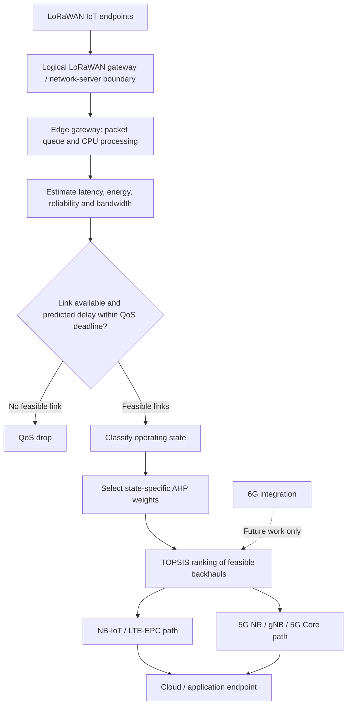

# Technical Review and Audit

This consolidated document merges the executive technical audit and the detailed final technical review. The source code, result CSVs and final academic PDFs remain the primary evidence. This document records scope, implementation, interpretation and validity limits. Source paths and result paths in the detailed historical audit sections are relative to `simulation/` unless stated otherwise.

**Status clarification (17 November 2026):** the audit snapshots embedded below were originally written on 13–14 November and retain their historical status. After those snapshots, the project team reported successful local Windows execution of the original package. This final release restructures the repository paths; the browser tests, application verifier, source compilation, HTTP resource checks and 15 SimPy-independent Python tests were rerun against the new layout. The full SimPy-dependent 25-test suite was not rerun in this packaging environment because SimPy was unavailable. Re-run it once after extracting this reorganised release.

---

## Executive technical audit

# Executive Technical Audit

**Project:** Unifying 5G/6G with LPWAN — AHP-TOPSIS-Based Adaptive Edge-Gateway Backhaul Selection  
**Audit date:** 14 November 2026

## Overall assessment

The audited package preserves the implemented five-layer, gateway-centric framework. A logical edge gateway receives aggregated LoRaWAN-originated traffic and selects between an NB-IoT/LTE-EPC-style cellular path and a 5G-NR/gNB/5GC-style path. The decision method remains hard QoS feasibility filtering followed by state-dependent AHP weighting and TOPSIS ranking. Six strategies are retained.

The package is **technically ready for local validation**, not yet fully submission-ready: native Windows execution remains pending, and student/institutional placeholders must be completed. The full primary experiment was not rerun; its archived result matrix was audited and retained. A separate supplementary 5G-outage pilot was freshly reproduced.

## Verified strengths

- Primary experiment: 24 configurations × 30 paired seeds × six strategies = **4,320 raw records**.
- The primary data have zero duplicate `(Scenario, Algorithm, Seed)` keys; the paired statistics contain 144 rows and selection analysis contains 2,880 unique scenario/seed/state rows.
- The selection analysis contains **5,768,175 AHP ranking calls**.
- The full automated test suite now passes **25 tests** (0 failures, 0 skipped); Python compilation succeeds and a smoke run completes all six strategies.
- The separate outage pilot was freshly rerun in a clean clone: five seeds × six strategies = **30 records**. Its five per-seed outputs, raw metric table, and selection summary match the archived pilot; derived confidence-interval handling and paired diagnostics were intentionally corrected.
- Eight figures were regenerated from the canonical primary and supplementary sources.
- Cumulative energy is internally additive to floating-point precision: CPU energy + NB-IoT setup/transmission energy + 5G setup/transmission energy.

## Main findings and modelling limitations

### 5G selection dominance

Adaptive AHP-TOPSIS selected 5G in every recorded primary ranking decision and selected NB-IoT zero times. This is not hidden or force-corrected. From the 5,768,175 ranking calls, 5G Pareto-dominates NB-IoT in 4,827,117 calls (83.69% of all ranking calls; 96.13% when both candidates are feasible), neither dominates in 194,210 calls (3.37% of all calls), and exactly one candidate is feasible in 746,848 calls (12.95%). Calls where neither is feasible are rejected before ranking and are not in this denominator.

At representative initial-sleep inputs for a 50-byte telemetry packet, predicted latency / marginal energy are 2.006061 s / 1.506061 J for NB-IoT and 0.120004 s / 0.500012 J for 5G. Configured reliability and bandwidth also favour 5G. For a 200-byte emergency packet, NB-IoT fails the 1-second predicted-latency feasibility test while 5G remains feasible. These are model inputs, not hardware measurements.

### Paired-statistics correction

An identified inferential defect was corrected. A paired-difference vector with zero sample variance does not yield an estimable conventional Student-t statistic, t-based confidence interval, or Cohen's dz. The previous handling assigned p = 1.0 to identical paired observations; the corrected shared helper keeps descriptive zero differences but leaves inferential fields as NaN and labels the case `ZERO_VARIANCE_IDENTICAL`. Constant non-zero differences are likewise marked non-estimable. The audit now adds Wilcoxon signed-rank sensitivity tests, Shapiro-Wilk diagnostics, and Benjamini-Hochberg adjustment separately by metric and test method. For the primary set, 96 of 120 pairwise comparisons per metric are exact zero-difference identities; 24 per metric have estimable paired-t tests.

### Undefined emergency latency

The 60 missing `Emerg_Lat_s` values all occur in NB-IoT `G_LOAD_4.0` and `G_LOAD_8.0` records with `Emerg_PDR = 0`. No emergency packets were successfully delivered in those observations, so a delivered-packet mean latency is undefined. These are retained as NaN; zero would falsely represent a successfully delivered packet with zero delay.

### Energy-model limitation

The selector estimates immediate marginal packet energy; cumulative simulation energy includes modem setup/transmission and gateway CPU processing over the full run. It does not forecast future modem wake-up cycles. In the seed-1000 diagnostic, NB-IoT had 10 modem wake/setup cycles while 5G had 141. Baseline average cumulative energy is 129.29 J for fixed NB-IoT and 135.24 J for fixed 5G/adaptive AHP-TOPSIS. No horizon-aware estimator was added because it would require a calibrated, validated future-cost model. Sleep and idle-tail leakage remain excluded.

## Scope and standards boundaries

- LoRaWAN is the non-cellular LPWAN access technology. NB-IoT is a cellular LPWAN alternative. The simulation places the cellular decision at a logical gateway; it does not implement direct LoRaWAN-device-to-5G-Core integration.
- N3IWF is the 5GC access function for untrusted non-3GPP access; a UE uses the relevant non-3GPP access and establishes the specified secure tunnel. It is not a generic LoRaWAN gateway interface.
- ATSSS is a UE/5GC feature associated with multi-access PDU-session steering/switching/splitting and its policy/protocol procedures. The gateway-side AHP-TOPSIS policy does not implement ATSSS or demonstrate compliance.
- 6G/IMT-2030 is future architectural context only. No 6G radio, core, or protocol stack is simulated.
- The `Switches` field in the outage pilot counts selected-backhaul label changes, not a standards-level mobility handover.

Standards versions checked for the current report: 3GPP TS 23.501 v19.9.0 (Release 19, published October 2026); 3GPP TS 23.503 v19.8.0 (Release 19, July 2026); and ITU-R Recommendation M.2160-0 (November 2023, in force). These standards are background references, not evidence of simulator conformance.

## Validation boundary

| Validation | Result |
|---|---|
| `python -m compileall -q src experiments tests` | Passed |
| `python -m pytest -q` | **25 passed, 0 failed, 0 skipped** |
| Smoke simulation | Six strategies completed |
| Primary raw archive | 4,320 rows audited; no full rerun claimed |
| Outage pilot | 30 simulations freshly run in a clean clone |
| Figure generation | Eight figures generated |
| Native Windows execution | Earlier audit: pending; team later reported successful local run on the pre-reorganisation layout. Recheck after this path reorganisation. |
| Physical radio/modem/LoRaWAN/5GC/6G validation | Not performed |

## Remaining work before submission

1. After extracting this final reorganised repository, create a fresh Windows virtual environment and rerun the Python test suite, application tests, verifier and smoke test using the root README commands.
2. Replace all bracketed student, roll-number, institute, department and faculty-guide placeholders; obtain required signatures/approvals.
3. Confirm the institution's formatting, declaration, reference style and AI-use disclosure requirements.
4. Preserve the 4,320-row primary dataset and five-seed pilot as separate evidence; do not claim the primary experiment was rerun.

See `docs/VALIDATION.md`, `docs/EXPERIMENTS_AND_REPRODUCIBILITY.md`, and `docs/CHANGELOG.md` for the consolidated evidence and file-level changes.

---

## Detailed technical review

# Final Technical Review and Results Interpretation

**Project:** Unifying 5G/6G with LPWAN — Adaptive Edge-Gateway Backhaul Selection  
**Review date:** 13 November 2026

## 1. Executive assessment

The submitted implementation is a working discrete-event simulation of a logical LoRaWAN edge gateway choosing between two cellular backhaul alternatives: NB-IoT over an LTE/EPC-style path and 5G NR through a gNB/5G-Core-style path. It implements hard QoS feasibility filtering followed by state-dependent AHP weighting and TOPSIS ranking. It compares six selection strategies over 24 configurations and 30 paired random seeds.

The code, tests, raw experiment matrix, processed statistics, selection analysis, figures, and tables are present. The complete test suite was independently rerun: 25 tests passed, 0 failed and 0 skipped. Python compilation and a fresh six-strategy smoke run passed. The supplementary five-seed 5G-outage pilot was freshly executed in a clean working copy: all five seed files, the 30-row raw metrics table and the six-row selection summary matched the archived pilot. The derived summary confidence intervals and paired diagnostics were deliberately corrected for zero-variance samples and extended with Wilcoxon/Shapiro sensitivity fields.

**The central scientific result must be stated carefully:** with the current parameterization and per-packet prediction model, Adaptive AHP-TOPSIS selected 5G in every logged ranking decision. The current experiments therefore do not demonstrate switching between NB-IoT and 5G as conditions or AHP state change, nor do they demonstrate an adaptive-algorithm performance advantage over fixed 5G. They do demonstrate a comparative simulation in which 5G is generally favoured by the model's latency, reliability, bandwidth, and predicted-energy inputs.

This is not a reason to discard the project. It is the result the current implementation produced. Present it honestly as an implemented framework and simulation evaluation, with state-diverse selection and improved energy prediction identified as future work.

## 2. Framework implemented

The project uses five logical integration layers:

1. **Device layer:** LoRaWAN endpoint traffic is represented by an aggregate packet-arrival process. Endpoint MAC/radio details are abstracted.
2. **Gateway/access layer:** a logical edge gateway represents the LoRaWAN gateway and network-server boundary. Detailed LoRaWAN MAC, deduplication, and radio airtime are not simulated.
3. **Edge management/orchestration layer:** packet deadline and link availability determine feasible alternatives; the gateway classifies operating state and selects among feasible alternatives using latency, energy, reliability, and bandwidth.
4. **Cellular backhaul/core layer:** the selected packet path is represented by either NB-IoT/LTE-EPC-style backhaul or 5G-NR/gNB/5GC-style backhaul.
5. **Application/data layer:** successfully delivered packets reach the simulated cloud/application endpoint.

The diagram represents logical alternatives, not a standards-conformance network implementation. **6G is future work; it is not simulated in this project.** NB-IoT is treated as an LTE/EPC-based cellular alternative, not as 5G NR access. N3IWF is not used as a normal NR radio-access path.

## 3. Implemented decision algorithm

For each packet, the gateway:

1. Accounts for CPU queueing and processing.
2. Estimates the packet's delay and energy on each modem and obtains configured reliability and bandwidth values.
3. Marks a link feasible only when it is available and its predicted packet delay meets the deadline: 1 second for emergency traffic and 10 seconds for telemetry.
4. Drops the packet when no link is feasible.
5. Classifies the state using emergency status and battery percentage. Emergency plus battery below 20% maps to `CONFLICT`; otherwise it maps to `EMERGENCY`, `LOW_BATTERY`, or `NORMAL`.
6. Derives AHP weights from the corresponding reciprocal pairwise-comparison matrix.
7. Applies TOPSIS to the feasible alternatives using latency (cost), energy (cost), reliability (benefit), and bandwidth (benefit).
8. Dispatches the packet through the selected backhaul.

| State | Latency | Energy | Reliability | Bandwidth |
|---|---:|---:|---:|---:|
| NORMAL | 2/13 | 6/13 | 2/13 | 3/13 |
| EMERGENCY | 4/8 | 1/8 | 2/8 | 1/8 |
| LOW_BATTERY | 1/8 | 5/8 | 1/8 | 1/8 |
| CONFLICT | 4/11 | 4/11 | 2/11 | 1/11 |

These are design-specified preference weights. The pairwise matrices are built directly from the ratios of the target weights, making them perfectly consistent by construction. They are **not** weights elicited from a survey or learned from field data. The selection method is multi-criteria decision logic, not a trained machine-learning model.

The six evaluated strategies are Fixed NB-IoT (`NB`), Fixed 5G (`5G`), latency-first (`LAT`), energy-first (`ENG`), static equal-weight AHP-TOPSIS (`TOP`), and state-dependent AHP-TOPSIS (`AHP`). Fixed strategies do not silently fall back to the other link.

## 4. Validation and data integrity

The following checks were completed against the uploaded archive:

| Check | Result |
|---|---:|
| Full pytest suite (10 core + 10 standalone audit/math tests + 5 paired-inference tests) | **25 passed** |
| Fresh smoke run | **6/6 algorithms completed** |
| Raw paired metrics | **4,320 rows** |
| Paired-statistics output | **144 rows** |
| AHP selection analysis | **2,880 rows** |
| Scenarios | **24**, each with 180 rows |
| Seeds | **30** (1000–1029) |
| Duplicate `(Scenario, Algorithm, Seed)` keys | **0** |
| Duplicate `(Scenario, Seed, AHP_State)` keys | **0** |
| AHP selection count mismatches | **0** |
| Primary vs backup CSV copies | **All four checked files byte-identical** |
| Re-generated figures | **8** (7 primary + 1 separate pilot) |
| Re-generated summary tables | **8** |

The smoke run and tests were executed with Python 3.13.5, using SimPy 4.1.2 extracted from the original archive because the host did not have SimPy installed and network access was unavailable. NumPy 2.3.5, Pandas 2.2.3, SciPy 1.17.0, Matplotlib 3.10.8 and pytest 9.0.2 were available. The original full 4,320-run primary experiment was **not** rerun; its existing CSV outputs were audited and retained. The separate five-seed outage pilot was independently rerun and matched the included result CSVs exactly.

Structural integrity checks establish that the expected rows, keys, and selection totals are present. They do not independently prove every modelling assumption or physical parameter is realistic.

## 5. Main quantitative findings

### 5.1 Baseline (`A_NORMAL`)

Averages across 30 paired seeds:

| Strategy | PDR | Mean latency | 95th-percentile latency | Emergency PDR | Total energy |
|---|---:|---:|---:|---:|---:|
| Fixed NB-IoT | 86.83% | 2.8689 s | 7.3506 s | 16.88% | 129.29 J |
| Fixed 5G | 99.02% | 0.02743 s | 0.03052 s | 99.10% | 135.24 J |
| Adaptive AHP-TOPSIS | 99.02% | 0.02743 s | 0.03052 s | 99.10% | 135.24 J |

Under the configured baseline, 5G/AHP has approximately 105 times lower mean latency than fixed NB-IoT, and about 12.19 percentage points higher packet-delivery ratio. Fixed NB-IoT uses about 4.60% less measured total energy than fixed 5G in this particular 2-packet/s scenario. The energy difference is small compared with the latency and PDR differences.

The 5G, latency-first, energy-first, static TOPSIS, and adaptive AHP strategies produce identical baseline delivery, latency, and energy outcomes because they all select 5G for the packets they route. Their computation overhead differs.

### 5.2 Load sweep

| Offered load | NB-IoT PDR | AHP/5G PDR | NB-IoT mean latency | AHP/5G mean latency |
|---:|---:|---:|---:|---:|
| 0.5 packets/s | 90.42% | 99.03% | 1.1735 s | 0.0621 s |
| 1 packet/s | 91.25% | 99.02% | 1.0105 s | 0.0393 s |
| 2 packets/s | 86.83% | 99.02% | 2.8689 s | 0.0274 s |
| 4 packets/s | 46.91% | 99.01% | 9.6044 s | 0.0259 s |
| 8 packets/s | 23.48% | 99.00% | 9.8441 s | 0.0269 s |

The configured NB-IoT service path degrades substantially at higher offered loads. AHP continues to choose 5G, so the AHP load-sweep line represents 5G's performance in these runs, not an independent adaptive gain over Fixed 5G.

### 5.3 Reliability sensitivity

Measured PDR changes as the configured loss probability is varied:

| Sweep | Configured loss | Measured PDR |
|---|---:|---:|
| NB-IoT | 1% | 90.57% |
| NB-IoT | 5% | 86.83% |
| NB-IoT | 10% | 82.28% |
| 5G | 1% | 99.02% |
| 5G | 5% | 94.98% |
| 5G | 10% | 89.99% |

Measured PDR is not simply `100% - configured loss`: it also reflects QoS drops and packets still in flight at the simulation horizon.

### 5.4 AHP selection behaviour

Across the archived AHP selection-analysis file, there are **5,768,175 logged ranking decisions**. NB-IoT was selected **zero** times; 5G was selected **100%** of the time. This remains true across the four recorded states and all 24 scenarios.

This means the code implements state-dependent weights, but the current experiment does not demonstrate state-dependent network switching. In many decisions, 5G is the only QoS-feasible option or Pareto-dominates NB-IoT under the supplied decision estimates. Even where neither option dominates, the TOPSIS result is 5G for these configured weights and values.

The supplied unit test `test_ahp_synthetic_tradeoff` separately verifies that a deliberately constructed synthetic trade-off can make NORMAL and EMERGENCY select different links. That is a unit test of algorithm behaviour, not evidence that the real simulation scenarios produced such switching.

### 5.5 Supplementary controlled decision-sensitivity analysis

A separate 800-case offline sensitivity analysis was added after the primary experiment audit. It reuses the implemented AHP and TOPSIS classes and holds predicted latency, configured reliability, bandwidth, and QoS deadlines fixed. It varies only a hypothetical multiplicative scale applied to the NB-IoT per-packet energy estimate from 0.01 to 1.00, in 0.01 increments, for 50-byte and 200-byte packets and all four AHP states.

| Payload | State | Highest NB energy-estimate scale at which NB is selected | Interpretation |
|---:|---|---:|---|
| 50 bytes | NORMAL | 0.12 | NB is selected only when its hypothetical energy estimate is reduced substantially |
| 50 bytes | LOW_BATTERY | 0.22 | The higher energy weight makes NB selectable over a wider scale range |
| 200 bytes | NORMAL | 0.12 | Same qualitative pattern |
| 200 bytes | LOW_BATTERY | 0.21 | Same qualitative pattern |
| 50/200 bytes | EMERGENCY | Not selected | NB predicted latency exceeds the 1-second emergency deadline, so it is infeasible |
| 50/200 bytes | CONFLICT | Not selected | NB predicted latency exceeds the 1-second emergency deadline, so it is infeasible |

This controlled test demonstrates that the implemented state-dependent weights can produce different choices in a constructed trade-off: at a scale of 0.20, LOW_BATTERY selects NB while NORMAL selects 5G. It is **not** a calibrated energy model, a new discrete-event network simulation, or evidence that real NB-IoT consumes 80% less energy. The scale is a hypothetical perturbation used to inspect decision sensitivity. It does not change the primary 4,320-run dataset or its conclusions. The existing emergency deadline correctly prevents selection of the slower NB-IoT alternative in the emergency states.

Artifacts are in `results/supplementary/`: `decision_sensitivity.csv` (800 rows), `decision_sensitivity_summary.csv` (8 state/payload summaries), and `decision_sensitivity.png`. Reproduce them with `python experiments/supplementary_decision_sensitivity.py`.

### 5.6 Energy-model diagnosis

The stored baseline mean energy breaks down as follows:

| Component | Fixed NB-IoT | Fixed 5G / AHP |
|---|---:|---:|
| Gateway CPU | 71.86 J | 71.86 J |
| NB-IoT setup + TX | 57.43 J | 0 J |
| 5G setup + TX | 0 J | 63.38 J |
| **Total** | **129.29 J** | **135.24 J** |

A separate diagnostic rerun of seed 1000 (not added to the primary CSVs) showed the mechanism clearly:

- Fixed NB-IoT: 10 wake-ups, 15.0 J setup energy, 41.739 J transmission energy, 56.739 J modem energy.
- Fixed 5G: 141 wake-ups, 70.5 J setup energy, 0.111 J transmission energy, 70.611 J modem energy.

The slower NB-IoT service kept its modem active for longer in this particular high-utilization traffic trace. The faster 5G modem processed packets quickly and repeatedly returned to sleep after its 2-second tail timer, incurring more setup events. This is a diagnosis from the simulator, not a universal property of NB-IoT and 5G hardware.

The current `estimate_energy()` is an **instantaneous next-packet estimate**: it includes that packet's transmission energy and includes a setup cost if the modem is currently asleep. It does not estimate expected future wake-ups or amortize setup energy over an arrival horizon. This helps explain why the ranking input can disagree with aggregate energy measured over the full run. The model also excludes sleep and idle-tail leakage, so `Total_Eng_J` is not a complete real-modem energy measurement.

Do not tune the NB-IoT energy scale to 0.2 merely to make the LOW_BATTERY test select NB-IoT and then present that as a realistic result. That offline sensitivity test changes the assumed energy input; it does not establish that the parameter is physically justified.

### 5.6 Algorithm computation overhead

Mean measured selection execution times in `J_OVERHEAD`:

| Strategy | Mean decision time |
|---|---:|
| Fixed NB-IoT | 0.796 µs |
| Fixed 5G | 0.861 µs |
| Latency-first | 10.271 µs |
| Energy-first | 10.122 µs |
| Static TOPSIS | 303.625 µs |
| Adaptive AHP-TOPSIS | 516.425 µs |

These are Python decision-function timings, not network latency. Adaptive AHP-TOPSIS has higher computational overhead than the simpler rules, but the observed mean is still approximately 0.52 ms per decision in this simulation environment.

## 6. Important interpretation limits

1. **6G is not implemented.** It is a future integration direction only.
2. **This is a discrete-event abstraction, not an operator-grade network simulator or standards-conformance implementation.** It omits detailed LoRaWAN MAC/radio airtime, real cellular scheduling, handover, mobility, radio propagation, full EPC/5GC procedures, and measured modem power profiles.
3. **Traffic from 200 endpoints is aggregated into one Poisson arrival stream.** Individual endpoint behaviour, spatial distribution, and correlated traffic are not represented.
4. **Energy is partial.** The reported total includes CPU processing plus modem setup and payload-transmission energy; sleep and idle-tail power are excluded. The energy assumptions are illustrative, not calibrated hardware measurements.
5. **The backhaul service model is simplified.** Each modem is a serial SimPy service process; its configured base latency contributes to service occupancy as well as packet delay.
6. **PDR is measured at the 3,600-second horizon.** Packets still queued or in flight when the simulation ends are counted as not delivered in that run. No post-horizon drain interval is used. Average latency is calculated only for delivered packets, so it does not include the eventual latency of unfinished packets.
7. **The 24-configuration primary set includes an NB-IoT outage** (at 2,000 s for 30 s). A separate five-seed supplementary pilot injects 5G unavailability from 2,000 s to 2,030 s and verifies eligible NB-IoT fallback plus 5G selection after recovery. This pilot is a small-sample behaviour check, not a primary scenario, general performance result, or standards-level handover test. The latency-degradation scenario changes 5G base latency from 20 ms to 150 ms for 60 s; it is not a capacity-congestion event.
8. **The AHP weights are design choices.** They are not derived from expert elicitation, field measurements, or training data.
9. **Paired-test p-values are unadjusted.** The report tables conduct multiple paired comparisons against AHP; no family-wise or false-discovery correction is applied. Report effect sizes and confidence intervals alongside p-values, and avoid treating a small p-value alone as proof of broad generality.
10. **The selection analysis reports decisions that reached ranking.** Packets rejected because no link was feasible are not AHP ranking decisions.

## 7. Suggested honest conclusion for the project report

> This work designed and implemented a five-layer logical framework for forwarding LoRaWAN-originated IoT traffic through an edge gateway to either an NB-IoT/LTE-EPC-style or 5G-NR/5G-Core-style backhaul. The gateway applies hard QoS feasibility filtering followed by a state-dependent AHP-TOPSIS decision process using latency, gateway energy, reliability, and bandwidth. A discrete-event simulation compared six backhaul-selection strategies over 24 configurations and 30 paired seeds. Under the configured assumptions, the 5G path achieved 99.02% packet delivery and 27.43 ms mean latency in the baseline, compared with 86.83% and 2.869 s for fixed NB-IoT. The adaptive method selected 5G for all logged ranking decisions and matched fixed 5G performance; therefore, this study does not claim a demonstrated adaptive-selection advantage. The results expose the importance of modelling expected modem wake-up and setup costs over time: instantaneous per-packet energy estimates do not fully capture the aggregate energy behaviour observed in the simulation. A separate five-seed 5G outage/recovery pilot verifies availability-driven fallback for eligible packets, but larger paired studies are needed. Future work will calibrate radio/backhaul and power models, incorporate horizon-aware energy prediction, extend outage studies, and investigate 6G integration.

## 8. Recommended viva answers

**Q: Is this really a framework for unifying LPWAN with 5G/6G?**  
A: It is a logical gateway/backhaul-selection framework connecting LoRaWAN-originated traffic to two cellular backhaul alternatives. The current prototype evaluates NB-IoT/LTE-EPC-style and 5G-NR/5GC-style paths. 6G integration is proposed as future work, not claimed as implemented.

**Q: What is the novelty or contribution?**  
A: The project combines QoS-based feasibility filtering with state-dependent AHP-TOPSIS backhaul selection in a five-layer edge-gateway framework, then evaluates it against fixed and single-criterion baselines under load, reliability, latency-degradation, outage, and energy-sensitivity scenarios. The contribution is a simulation framework and evaluation, not a claim of a new 3GPP protocol or a proven adaptive performance win.

**Q: Why does AHP select 5G all the time?**  
A: Under the chosen parameters, 5G has much lower latency, higher bandwidth, and higher configured reliability. The current per-packet energy predictor does not fully account for future wake-up/setup frequency. Consequently, changing AHP weights did not change the selected link in the primary scenarios.

**Q: Why can NB-IoT have lower measured energy in the baseline?**  
A: At the baseline 2-packet/s load, the slower NB-IoT service remains active for longer and incurs fewer wake-up/setup events. The faster 5G modem returns to sleep after idle gaps and pays repeated setup costs. The seed-1000 diagnostic showed 10 NB-IoT wake-ups versus 141 5G wake-ups. This result is specific to the assumed traffic, tail timer, and energy parameters.

**Q: Did you simulate 6G?**  
A: No. The implemented comparison is NB-IoT/LTE-EPC-style versus 5G NR/5GC-style. 6G is included as a future integration direction.

**Q: Are the AHP weights learned from experts?**  
A: No. They are explicit design preferences encoded as consistent pairwise-ratio matrices. A future study should elicit and validate these preferences with domain experts or operational data.

## 9. Submission checklist

- [ ] Include this technical review alongside the project report.
- [ ] Include the five-layer architecture diagram and the algorithm flow in the report/presentation.
- [ ] State explicitly that 6G is future work.
- [ ] Report the observed 100% 5G AHP selection honestly; do not claim adaptive switching or superiority over Fixed 5G.
- [ ] Distinguish configured link loss from measured PDR and explain that PDR is horizon-based.
- [ ] State the energy accounting scope and the instantaneous-estimator limitation.
- [ ] Include the eight regenerated figures (seven primary figures plus the separately labelled pilot figure) and relevant CSV tables.
- [ ] Cite and discuss the literature review separately; the uploaded ZIP contains implementation documentation but no full literature-survey chapter or bibliography.

## 10. Follow-up audit additions and recommended final experiment

A reproducible post-processing script, `experiments/audit_existing_results.py`, was added after the original review. It regenerates AHP consistency values, selection-dominance summaries, initial-sleep candidate input comparisons, and paired comparisons with Benjamini-Hochberg FDR-adjusted q-values and paired Cohen's dz effect sizes.

For the archived 24-configuration data, the four state matrices each have `lambda_max = 4.000000`, `CI = 0.000000`, and `CR = 0.000000`. This is expected because the pairwise matrix is built directly as `a_ij = w_i / w_j`. It validates consistency of the encoded matrix, not the empirical validity of the chosen preference weights.

The archived selection-analysis data records 5,768,175 AHP selection calls: 5G is selected in all calls. Across those calls, 5G Pareto-dominates NB-IoT in 4,827,117 (83.69%); neither option dominates the other in 194,210 (3.37%); and only one alternative is feasible in 746,848 (12.95%). Therefore, do not claim that 5G Pareto-dominates every decision. In the `NO_DOM` cases, TOPSIS still selects 5G after considering the weighted criteria.

The existing `Switches` field is already present in the simulation output. It counts changes in the gateway's selected backhaul label; it is not a full 3GPP mobility or handover procedure. All archived 24-configuration runs have zero such changes.

The separate `experiments/run_5g_outage_supplementary.py` pilot injects a 30-second 5G availability outage beginning at simulation time 2,000 s. It was rerun for seeds 1000–1004 (five seeds × six strategies = 30 records). The four generated result tables exactly match the supplied package outputs. For adaptive AHP-TOPSIS, mean NB-IoT selections during the outage are 57.2 per seed; 5G selections during unavailability are zero; post-recovery 5G selections average 3,098.2; and the selected-backhaul label changes twice per seed on average. Mean PDR is 98.935% (n=5). This result is a small-sample functional demonstration, not a new primary configuration.

The primary matrix remains 24 configurations / 4,320 raw rows / 144 paired-statistics rows / 2,880 selection-analysis rows. Do not append the 30 pilot rows to those files. The `Switches` count is a selected-backhaul label-change counter, not standards-compliant handover signalling.

See `docs/EXPERIMENTS_AND_REPRODUCIBILITY.md` and `docs/VALIDATION.md` for the consolidated outputs and commands.

### 5.6 Pareto and paired-inference audit

Pareto analysis minimizes predicted latency and instantaneous marginal gateway energy and maximizes configured reliability and nominal bandwidth. For two feasible alternatives, dominance requires no worse values on all four criteria and a strict improvement on at least one. Across 5,768,175 ranking calls, 5G dominates 83.69% of all calls (96.13% where both alternatives are feasible); neither dominates in 3.37%; and exactly one candidate is feasible in 12.95%. Calls where neither alternative is feasible are rejected before ranking.

The paired-statistics helper no longer assigns p = 1.0 to exact-zero paired differences. For 96 of 120 comparisons per metric, paired differences have zero sample variance; t statistics, p-values, t intervals and Cohen's dz are non-estimable and are stored as NaN. Twenty-four comparisons per metric have estimable paired t-tests. Shapiro-Wilk diagnostics, Wilcoxon signed-rank sensitivity and per-metric/per-method Benjamini-Hochberg q-values are provided. Sixty emergency-latency NaNs are linked to zero emergency delivery (no delivered observations).
